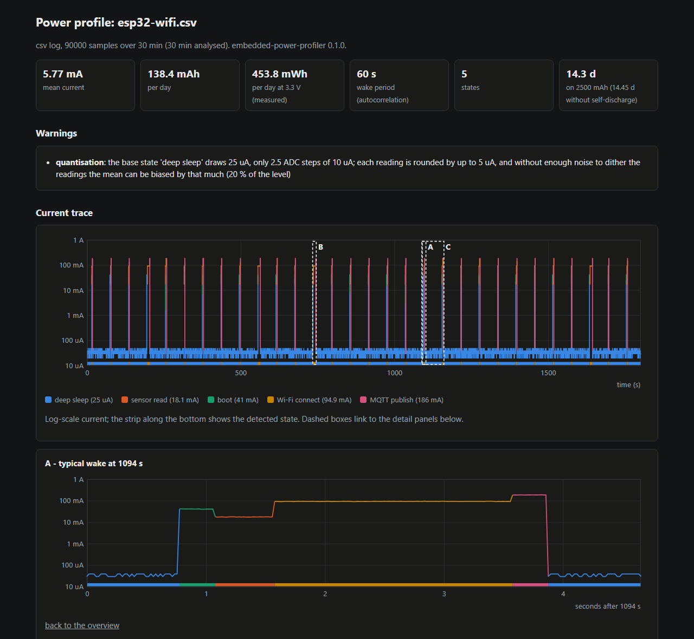
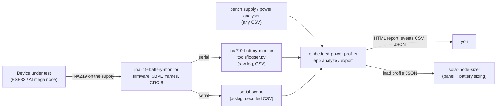
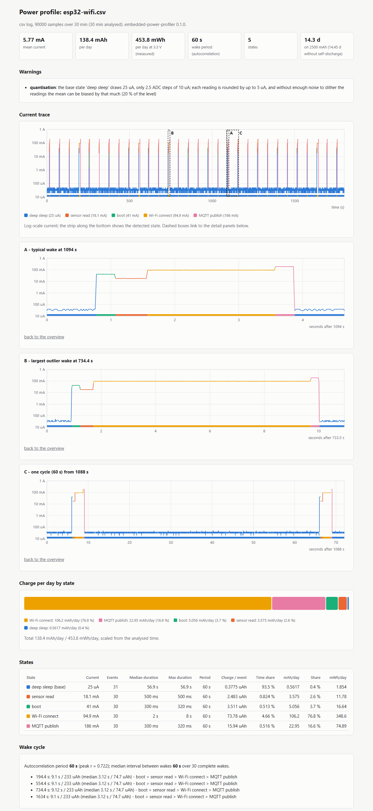

# embedded-power-profiler

[](https://github.com/projectbin07-stack/embedded-power-profiler/actions/workflows/ci.yml)
[](LICENSE)

Turn a current/voltage log of an embedded device into an energy budget per operating state, and
hand that budget to [solar-node-sizer](https://github.com/projectbin07-stack/solar-node-sizer).

`epp` reads a log recorded with
[ina219-battery-monitor](https://github.com/projectbin07-stack/ina219-battery-monitor),
[serial-scope](https://github.com/projectbin07-stack/serial-scope) or any CSV, finds the
operating states (deep sleep, boot, sensor read, radio...) with change-point detection and level
clustering, and reports per state: current, duration, repetition period, charge per event and per
day, and share of the total. It finds the wake period, flags outlier events such as a Wi-Fi
reconnect that took four times longer, estimates battery life, writes a self-contained HTML
report, and exports a load profile that solar-node-sizer (v0.1.2 or newer for its browser
app; any version for its CLI) loads unchanged.

> **Validation status.** Everything in this README, the tests and the screenshots comes from
> **synthetic traces** produced by the tool's own generator (and from the other projects'
> synthetic demo logs). Nothing has been validated against a physical device or a reference power
> analyser yet. The synthetic profiles use illustrative currents, not measurements of a
> particular board.



## Why it exists

A sensor node's battery life is decided by a few bursts per wake, each milliseconds to seconds
long, and by how many microamps it draws in between. A logged trace contains that information, but
turning it into "sleep 25 uA, Wi-Fi 95 mA for 2.8 s every 60 s" by hand means scrolling through
hours of samples, guessing thresholds and redoing spreadsheet arithmetic every time the firmware
changes, and sizing tools then want that table typed in again. This project automates the middle
step and connects three released tools into one pipeline:



| Project | What `epp` uses | Checked how |
| --- | --- | --- |
| ina219-battery-monitor v0.2.0 | raw serial log (`$BM1,...*HH` lines, CRC-8) and the `tools/logger.py` CSV | independent decoder; CI runs that project's own `logger.py` on `epp`'s frames and `epp` on the CSV it writes |
| serial-scope v0.3.0 | `.sslog` raw logs (the `$BM1` frames inside are decoded) and its decoded CSV export | independent reader; CI installs serial-scope at the tag, reads `epp`'s `.sslog` with it, and analyses serial-scope's own demo log and CSV export |
| solar-node-sizer v0.1.2 | output: `load` states and a full config | CI checks out the tag and runs its `normalizeConfig`, `dailyBudget`, `autonomyHours`, CLI and the browser app's JSON import (`importConfigText`) on the export (see [compatibility](#solar-node-sizer-compatibility)) |

## Features

- **Loaders**: ina219-battery-monitor raw logs and logger CSV, serial-scope `.sslog` (rotated
  sets, truncated files) and its CSV export, and generic CSV with units taken from the header
  (`time_ms`, `Current (uA)`, `V [mV]`, ISO timestamps, `;`/tab delimiters) or given on the
  command line. Device clock unwrapping at 2^32 ms, device restarts (placed by host time when
  available), CRC rejects, overflow/sensor-error flags.
- **Resampling and gaps**: uniform grid by linear interpolation; nothing is interpolated across a
  gap (more than 3 sample periods by default), and gap time is excluded from durations and from
  the daily scaling.
- **Sample-rate limits**: warnings when a state lasts fewer than 2 samples (not resolved) or
  fewer than 10 (duration uncertain by one sample period), when single-sample excursions suggest
  bursts shorter than the sample period, for an explicit `--min-burst-ms`, and when the sleep
  current is only a few ADC steps.
- **State segmentation**: PELT change-point detection on log10 current with a Gaussian
  mean-and-variance cost and a quantisation-aware variance floor, then a one-dimensional Gaussian
  mixture (EM, sized by BIC) over the segment levels. Optional TOML/JSON states file mapping
  current bands to names.
- **Duty-cycle analysis**: per state mean current, events, median/max duration, repetition
  period, charge per event and per day, time and charge share; wake period by autocorrelation
  (FFT; numpy if installed, pure-Python fallback); outlier events and outlier wakes by a robust
  z-score.
- **Energy budget**: mAh/day and mWh/day at the measured voltage (or `--voltage`); battery life
  for a capacity with and without self-discharge, with solar-node-sizer's convention.
- **Exports**: solar-node-sizer load profile (partial config) or full config, events CSV, JSON,
  and a self-contained HTML report (inline SVG, no JavaScript, no CDN, light/dark).
- **Synthetic traces**: seeded profiles with a known duty cycle, ADC averaging across edges,
  noise, quantisation and occasional long reconnects, writable in every input format.

Runtime dependencies: none on Python 3.11+ (`tomli` on 3.10, for TOML state files); numpy is used
for the FFT when it is installed.

## Install

Not published to PyPI. Python 3.10 or newer:

```console
pip install "git+https://github.com/projectbin07-stack/embedded-power-profiler.git@v0.2.0"
pip install numpy   # optional: faster autocorrelation
```

## Quick start (real output, synthetic data)

All output below was produced by the commands shown, on Windows 11 with Python 3.14, from the
synthetic `esp32-wifi` profile (seed 1): an ESP32-class node that wakes every 60 s for boot
(42 mA, 0.3 s), sensor read (18 mA, 0.5 s), Wi-Fi connect (95 mA, 2 s; four times longer in 10 %
of the cycles) and MQTT publish (190 mA, 0.3 s), and sleeps at 25 uA; logged at 50 Hz with 10 uA
ADC steps.

```console
$ epp synth --profile esp32-wifi -o esp32.csv --states-out states.toml
wrote esp32.csv: synthetic 'esp32-wifi' (csv), 90000 samples, 1800 s, true charge 138.4 mAh/day
  deep sleep            25 uA    31 events      0.561 mAh/day
  boot                  42 mA    30 events       5.04 mAh/day
  sensor read           18 mA    30 events        3.6 mAh/day
  Wi-Fi connect         95 mA    30 events      106.4 mAh/day
  MQTT publish         190 mA    30 events       22.8 mAh/day
wrote states.toml

$ epp analyze esp32.csv --capacity-mah 2500 --report report.html
esp32.csv: csv, 90000 samples, 50 Hz, 30 min (30 min analysed)
segments 203 (52 folded), states 5, wake period 60 s (autocorrelation), 30 complete wakes

state                     current events median dur    period  uAh/event   mAh/day  share
sleep *                     25 uA     31     56.9 s      60 s     0.3775    0.5617   0.4%
active 18.1 mA            18.1 mA     30     500 ms      60 s      2.483     3.575   2.6%
active 41 mA                41 mA     30     300 ms      60 s      3.511     5.056   3.7%
radio 94.9 mA             94.9 mA     30        2 s      60 s      73.78     106.2  76.8%
radio 186 mA               186 mA     30     300 ms      60 s      15.94     22.95  16.6%
(* base state)

mean current  5.77 mA
charge/day    138.4 mAh
energy/day    453.8 mWh at 3.3 V (measured)
battery       2500 mAh x 0.8: 14.45 days, 14.3 days with 3 %/month self-discharge

outlier wakes (4):
      194.44 s  9.1 s / 233 uAh (median 3.12 s / 74.7 uAh)
      554.42 s  9.1 s / 233 uAh (median 3.12 s / 74.7 uAh)
      734.42 s  9.12 s / 233 uAh (median 3.12 s / 74.7 uAh)
     1634.44 s  9.1 s / 233 uAh (median 3.12 s / 74.7 uAh)

warnings (1):
  [quantisation] the base state 'sleep' draws 25 uA, only 2.5 ADC steps of 10 uA; each reading is rounded by up to 5 uA, and without enough noise to dither the readings the mean can be biased by that much (20 % of the level)

report written to report.html
```

Compared with the generator's ground truth: the daily charge is 138.4 mAh in both; the four
outlier wakes are exactly the four cycles with a long reconnect; the short bursts read 1-2 % low
(41 vs 42 mA, 186 vs 190 mA) because the one sample that straddles each edge is an average across
it. Without a states file the names are only current bands (`sleep` below 1 mA, `low-power`
below 10 mA, `active` below 80 mA, `radio` above). With one:

```console
$ cat states.toml
# States of the synthetic 'esp32-wifi' profile (bands between geometric midpoints).

[[state]]
name = "deep sleep"
max_ma = 0.6708

[[state]]
name = "sensor read"
min_ma = 0.6708
max_ma = 27.5
...

$ epp export esp32.csv --states states.toml --solar-node-sizer esp32-load.json
current taken as measured at the supply (generic CSV; --measured-at)
wrote esp32-load.json: 5 load states, 138.4 mAh/day measured
  deep sleep              0.0250371 mA  base
  sensor read                18.068 mA  every 60 s for 0.494667 s
  boot                      41.0383 mA  every 60 s for 0.308 s
  Wi-Fi connect             94.9105 mA  every 60 s for 2.79867 s
  MQTT publish               185.51 mA  every 60 s for 0.309333 s
  [quantisation] the base state 'deep sleep' draws 25 uA, only 2.5 ADC steps of 10 uA; ...
  (the warnings are also in the exported note)
```

`esp32-load.json` is a partial solar-node-sizer config (`name`, `note`, `load`; solar-node-sizer
fills in its defaults for everything else). `--full-config` writes every section with
solar-node-sizer's defaults plus the measured load, `--capacity-mah`, `--dod` and
`--self-discharge`. In a solar-node-sizer checkout: `node bin/solar-node-sizer.js simulate
esp32-load.json`, or in its browser app (v0.1.2 or newer) pick the file under "Start from" or
drop it on the page. Analysis warnings are appended to the config's `note`, and with `--strict`
an export that has warnings is not written.

### What a too-slow log looks like

The same node logged at 2 Hz, the ina219-battery-monitor firmware's default `RATE 500`:

```console
$ epp synth --profile esp32-wifi --rate 2 -o esp32-2hz.csv
wrote esp32-2hz.csv: synthetic 'esp32-wifi' (csv), 3600 samples, 1800 s, true charge 138.4 mAh/day
...
$ epp analyze esp32-2hz.csv
esp32-2hz.csv: csv, 3600 samples, 2 Hz, 30 min (30 min analysed)
segments 69 (4 folded), states 3, wake period 60 s (autocorrelation), 30 complete wakes

state                     current events median dur    period  uAh/event   mAh/day  share
sleep *                   24.9 uA     31     56.5 s      60 s     0.3734    0.5557   0.4%
active                      30 mA      4        1 s     6 min      8.332       1.6   1.0%
radio                     92.8 mA     30      3.5 s      60 s      107.4     154.7  98.6%
(* base state)

mean current  6.53 mA
charge/day    156.8 mAh
...
warnings (4):
  [sample-rate] 'active' lasts a median 1e+03 ms = 2 samples; each edge is uncertain by up to one period, so its duration may be off by +/-500 ms (+/-50 %). At least 10 samples per burst (f_s >= 10/d) keeps this under 10 %
  [sample-rate] 'radio' lasts a median 3.5e+03 ms = 7 samples; ...
  [aliasing] 4 single-sample excursion(s) above or below both neighbouring states were folded into a neighbour. ...
  [quantisation] ...
```

Only three of the five states are resolved and the daily charge comes out 13 % high
(156.8 vs 138.4 mAh), because point samples of 0.3-0.5 s bursts taken every 0.5 s are not a fair
average. The warnings say so; these numbers should not be used.

## Recommended logging setup

For ina219-battery-monitor (or any INA219-based logger):

- **Sample period**: as short as the firmware allows (`RATE 20`, 50 Hz) and at most one tenth of
  the shortest burst you care about. At 50 Hz a 0.3 s burst gets 15 samples; a 5 ms radio
  transmission cannot be resolved at all and needs a faster instrument.
- **Minimum sample rate**, as the warnings apply it: a rectangular burst of length `d` is certain
  to be sampled at least twice only if the sample period `T_s <= d/2`, i.e. `f_s >= 2/d` (the
  Nyquist-style limit for resolving it at all). Each edge is still uncertain by up to `T_s`, so
  the duration error is up to `T_s/d`; `f_s >= 10/d` keeps it under about 10 %.
- **ADC averaging** (`BM_ADC_MODE Avg16`, about 8.5 ms per shunt conversion): each sample is the
  average over its conversion window, not over the whole sample period. Bursts that fall between
  conversions are missed rather than averaged, which is why the sample rate matters more than the
  averaging.
- **Shunt and range**: with the firmware's default 0.1 ohm shunt and 3.2 A range the current step
  is about 0.1 mA, so a 10-50 uA sleep current reads as 0 or 0.1 mA. A 1 ohm shunt with a 320 mA
  range gives 10 uA steps (what the `esp32-wifi` synthetic profile assumes), at the cost of up to
  0.3 V burden voltage at 300 mA; check that your regulator tolerates it. For single-digit
  microamp sleep currents use an instrument made for that.
- Log at least three wake cycles (the tool warns below three), and enough cycles to catch the
  rare events you care about: a 10 % reconnect rate needs dozens of cycles to show reliably.
- Record the voltage on the same side as the current, and tell the export which side it is
  (`--measured-at supply|battery`). Without the option the export assumes the battery side for
  ina219-battery-monitor logs (its board senses high-side on the battery) and the supply side
  for generic CSVs, and prints which it used.
- Name the units in a generic CSV header (`current_ma`, `Current(uA)`, `I [A]`, or a column
  called just `mA`), or pass `--current-unit`. A current column without a unit is refused
  (exit 2): guessing mA read a log in amps 1000 times low.

## Methods

Notation: `i_k` current samples on a uniform grid of period `T` (mA), `v_k` volts, `n` samples.

**High-rate input.** A generic CSV sampled faster than 1 kHz (a PPK2 or Joulescope export,
for example) is read as a stream and block-averaged to 1 ms bins (or to `--resample-ms`) while it
is read: each bin's current is the mean of its samples and its time their mean time, so the
charge is preserved exactly, memory is proportional to the log's length in milliseconds, not to
its rows, and the change-point search runs on 1000 points a second. Bursts shorter than about two
bins are not resolved as states of their own (their charge still counts). Beyond 2 million bins
adjacent bins are merged. `--resample-ms` below the input's interval keeps every sample.

**Resampling.** Linear interpolation onto `t_0 + kT` (`T` = median input interval unless
`--resample-ms`). Consecutive input samples more than 3 `T` apart bound a gap; grid points inside
it stay empty, and every statistic runs per gap-free run.

**Transform.** `y_k = log10(max(i_k, 0) + i_f)`, with `i_f` the ADC step (detected as the
smallest difference between distinct readings when 99 % of the readings are multiples of it) or
1 uA. In this domain 20 -> 40 uA and 60 -> 120 mA are steps of the same size.

**Change points (PELT).** Minimise `sum_s C(segment_s) + beta * (number of change points)` with
the Gaussian mean-and-variance cost

    C(a, b)  = (b - a) * ln( max( var(y_a .. y_{b-1}), v_floor ) )
    v_floor  = max( SIGMA_MIN^2, ( q / ((I + i_f) ln 10) )^2 ),   q = ADC step / sqrt(12)

where `I` is the segment's current, so that a run of identical quantised readings cannot buy an
arbitrarily good fit (`SIGMA_MIN` = 0.003 decades). `beta = 2 * penalty * ln n` (penalty 2 by
default, a conservative BIC). PELT's pruning rule (`F(tau) + C(tau, t) > F(t)` discards `tau`)
keeps the minimisation exact; because nothing gets pruned inside long homogeneous sleep periods,
the search is restricted to candidate positions: samples where `y` moves by more than
`3 sqrt(2)` local noise levels within one or two samples (local noise = robust estimate from first
differences, `max(1.4826 median|dy|, q75|dy| / 1.1503) / sqrt 2`, the quietest of three
neighbouring 32-sample blocks), plus every 256th sample. The result is the exact optimum over
partitions whose boundaries lie on those positions; a test checks that it equals unrestricted
PELT on a step signal. Segments shorter than `--min-samples` (default 2) are folded into the
neighbour with the closer level; one that lies above or below both neighbours counts as an
excursion (aliasing warning).

**Level clustering.** Each segment contributes `x = log10(mean current + i_f)`. The sorted points
are first split wherever neighbours are more than 0.15 decades (a factor of 1.41) apart; within
each group a 1-D Gaussian mixture `p(x) = sum_j w_j N(x; mu_j, s_j^2)` is fitted by EM (quantile
initialisation, `s_j >= 0.02` decades) for `k = 1..k_max`, and the `k` with the lowest
`BIC = -2 ln L + (3k - 1) ln N` is kept. The gap rule matters for short logs: with two wakes BIC
alone cannot justify separate components. Consecutive segments in the same cluster form one
event. A states file names segments by band before clustering; segments in no band are clustered.

**Per state.** Level `I_s = Q_s / t_s` (charge over time, so charge is conserved); events; median
and max duration of complete events (events that touch the log edge or a gap are left out of the
duration statistics but not of the charge); period = median start-to-start interval; charge per
event `Q_s / N_s`; `mAh/day = Q_s * 86400 / t_covered`; shares of time and charge. The base state
is the one with the most time; a wake is everything between two stretches of the base state.

**Wake period.** Autocorrelation `r(L) = sum x_k x_{k+L} / sum x_k^2` of the mean-removed current
(block-averaged to at most 32768 points, gaps filled with the mean), computed by FFT with zero
padding. The period is the first local maximum that reaches 80 % of the highest peak (so `2T` is
not chosen over `T`), refined with a parabola through three points.

**Outliers.** For the complete events of each non-base state (duration) and for complete wakes
(duration and charge): flagged when the robust z-score `(x - median) / (1.4826 MAD) > 4` and
`x > 1.5 median`.

**Energy.** `E = sum_k i_k v_k T` (or `Q * --voltage`); daily figures scale by
`86400 / t_covered`.

**Battery life** (solar-node-sizer v0.1.2 convention, its `docs/models.md` section 10).
Self-discharge is proportional to the stored charge: per hour `s = 1 - (1 - m)^(1/730)` for `m`
per month, applied before the hourly load `p = (mAh/day) / 24`. From full, `E0 = capacity`:

    E_k = (E0 + p/s) (1 - s)^k - p/s        (s > 0)
    E_k = E0 - k p                          (s = 0)

Life is the last whole hour `N` with `E_N >= floor = (1 - dod) E0` plus `((1 - s) E_N - floor) / p`
of the next hour. Without self-discharge this is `dod * capacity / (mAh/day)`.

### Synthetic traces

`epp synth --profile esp32-wifi|atmega-nrf24` builds the true piecewise-constant current from a
periodic wake sequence (with period jitter and, for `esp32-wifi`, 10 % of cycles with a
four-times-longer Wi-Fi connect), then samples it the way an instrument would: the average over
the conversion window that ends at each sample (8.5 ms for the INA219-like profile), Gaussian
noise `0.01 |i| + noise_abs`, rounding to the ADC step, and a supply voltage `v0 - R i` rounded to
4 mV. The ground truth (intervals, per-state charge) comes with it; that is what the tests compare
against.

## solar-node-sizer compatibility

solar-node-sizer's load is a list of states: one has `"base": true` and fills the remaining time,
the others have `every` and `duration` in seconds; `mA` is the supply current. The export uses

    mA = Q_s / t_s,    every = t_covered / N_s,    duration = t_s / N_s

so `mA * duration / every` equals each state's measured mean contribution and solar-node-sizer's
daily budget reproduces the measured mAh/day (long outliers are in the mean duration, not
dropped). solar-node-sizer has no per-state voltage: the full config uses its `ldo-lowiq`
regulator when the measured supply is 3.3 V, a custom LDO at the measured voltage otherwise, or
`regulatorPreset: "none"` with `--measured-at battery`. Hour-of-day windows are not inferred.

Verified two ways:

1. `export.validate_sns_config` re-implements solar-node-sizer v0.1.2's structural checks
   (`normalizeConfig`, `normalizeLoad`). Every export passes through it, and the unit tests run
   it on solar-node-sizer's bundled example and on invalid configs.
2. CI checks out solar-node-sizer at tag `v0.1.2` and runs
   [`scripts/check_solar_node_sizer.mjs`](scripts/check_solar_node_sizer.mjs), which imports its
   `normalizeConfig`, `dailyBudget`, `autonomyHours` and `selfDischargePerHour`, plus its CLI
   (`simulate`). Local run on the trace above (`analysis.json` from
   `epp analyze esp32.csv --states states.toml --capacity-mah 2500 --json`):

```console
$ node scripts/check_solar_node_sizer.mjs ../solar-node-sizer esp32-load.json analysis.json
ok   normalizeConfig accepted esp32-load.json (5 load states)
ok   load states unchanged by normalizeConfig
ok   dailyBudget supply side 138.3957 mAh/day vs measured 138.3960 (0.0002 %)
     deep sleep               0.5617 mAh/day  22.4357 h/day
     sensor read              3.5751 mAh/day  0.1979 h/day
     boot                     5.0559 mAh/day  0.1232 h/day
     Wi-Fi connect            106.2493 mAh/day  1.1195 h/day
     MQTT publish             22.9537 mAh/day  0.1237 h/day
ok   battery life without self-discharge: solar-node-sizer 14.451 d, epp 14.4513245380508 d
ok   battery life with self-discharge: solar-node-sizer 14.296 d, epp 14.295973359228062 d
```

## Command reference

```console
$ epp --help
usage: epp [-h] [--version] {analyze,export,synth} ...

Turn a current/voltage log of an embedded device into an energy budget per
operating state.

positional arguments:
  {analyze,export,synth}
    analyze             detect states and print the energy budget
    export              write a solar-node-sizer load profile
    synth               write a synthetic trace for demos and tests

options:
  -h, --help            show this help message and exit
  --version             show program's version number and exit
```

`epp analyze LOG` options (shared by `export`; `epp analyze --help` lists them all):

| Option | Meaning |
| --- | --- |
| `--format auto\|ina219\|logger-csv\|sslog\|sslog-csv\|csv` | input format (auto-detected from the content) |
| `--time-col`, `--current-col`, `--voltage-col`, `--time-unit`, `--current-unit`, `--voltage-unit` | generic CSV columns and units when the header does not say |
| `--states FILE` | TOML/JSON states file (bands to names, optional `[analysis]` settings) |
| `--voltage V` | supply voltage for mWh when the log has none |
| `--resample-ms` | analysis grid; generic CSVs faster than 1 kHz are block-averaged to 1 ms, or to this |
| `--penalty` (2), `--min-samples` (2), `--max-states` (8) | analysis settings |
| `--min-burst-ms MS` | warn if the sample rate cannot resolve bursts this short |
| `--capacity-mah`, `--dod` (0.8), `--self-discharge` (0.03 per month) | battery life |
| `--report FILE.html`, `--json`, `--events-csv FILE` | outputs |
| `--strict` | exit 1 if there are warnings; `export` then writes nothing |

`epp export LOG --solar-node-sizer OUT.json [--full-config] [--measured-at supply|battery]
[--name NAME]` and `epp synth [--profile esp32-wifi|atmega-nrf24] -o OUT
[--format csv|ina219|logger-csv|sslog|sslog-csv] [--seed N] [--duration S] [--rate HZ]
[--states-out FILE.toml]`.

Exit codes: 0 success, 1 warnings with `--strict`, 2 unreadable input or invalid options.

States file:

```toml
[analysis]            # optional
penalty = 2.0
min_samples = 2
max_states = 8

[[state]]
name = "deep sleep"
max_ma = 1.0          # band [min_ma, max_ma), defaults 0 and infinity

[[state]]
name = "Wi-Fi"
min_ma = 60
```

## Report

`--report` writes one HTML file with inline SVG and CSS only (no JavaScript, no external
requests) that follows the system light/dark setting. The overview of the whole log outlines
three windows, each linked to a full-resolution panel below: a typical wake (median charge), the
largest outlier wake and one full cycle. State strips and bar segments have native tooltips.
Then come the stacked daily-charge bar, the per-state table, the wake cycle with its outliers,
battery life and the event table.



## Architecture

```
src/embedded_power_profiler/
  bm1.py          $BM1 frame codec and CRC-8 (ina219-battery-monitor format)
  sslog.py        serial-scope .sslog reader/writer, line reassembly
  loaders.py      format detection and the five loaders -> Trace
  trace.py        Trace, gap detection, uniform resampling, ADC-step estimate
  segment.py      PELT (mean / mean+variance cost), candidate positions, short-segment folding
  cluster.py      1-D Gaussian mixture by EM + BIC, gap-separated groups
  spectral.py     FFT (numpy or pure Python), autocorrelation, period peak
  analysis.py     pipeline: events, states, wakes, outliers, budget, warnings, JSON
  battery.py      battery life (port of solar-node-sizer's autonomyHours)
  export.py       solar-node-sizer profile/config, schema check, events CSV
  html_report.py  self-contained report
  synth.py        synthetic profiles with ground truth
  writers.py      writers for every input format (fixtures, demos)
  cli.py          epp analyze | export | synth
```

Performance, measured on the author's Windows 11 laptop with Python 3.14 and numpy installed: the
30-minute 50 Hz trace above (90,000 samples) analyses in under a second; a synthetic 24-hour log at
50 Hz (4.32 million samples) took 27 s, nearly all of it in pure-Python code. A generated
PPK2-style CSV of 3,000,000 rows (30 s at 100 kHz, 50 MB; 25 uA sleep, 80 mA for 300 ms every
6 s) analyses in 10-14 s with a peak working set of 43 MB, and gives 4.02 mA mean / 96.57 mAh/day
against 4.024 mA / 96.57 mAh/day by hand. Version 0.1.0 read the same file into memory row by
row and ran the change-point search on all 3 million samples: it was stopped after 734 s at
about 877 MB. On a 300,000-row cut of the file 0.1.0 took 147 s and 0.2.0 takes 1.2 s, with the
same table (25 uA and 80 mA states, 192.5 mAh/day).

## Testing

```console
pip install -e ".[dev]"
ruff check . && ruff format --check . && mypy && pytest --cov
```

Expected values come from the synthetic ground truth or are derived by hand in the test (CRC
check value, uvarint bytes, interpolation, the battery closed form against an hour-by-hour loop,
the FFT against a naive DFT). On the 30-minute `esp32-wifi` trace, for example, every state's
current must be within 3 % of the truth, durations within one sample, the daily charge within
0.05 %, and exactly the four long reconnects must be flagged. Fixtures in every input format
(`tests/fixtures/`) are written by the project's own writers (`python tests/make_fixtures.py`).
`tests/test_interop.py` runs serial-scope and ina219-battery-monitor's logger when they are
available (CI installs them at pinned tags). CI runs on Ubuntu and Windows with Python 3.10 and
3.13, once more with numpy uninstalled, and in the interop job.

## Known limitations

- **No hardware validation.** Not compared with a physical device or a reference power analyser;
  all bundled results come from synthetic traces.
- Short bursts read slightly towards their neighbours (1-2 % at 15 samples per burst, up to about
  10 % at 6 samples) because the samples that straddle edges are averages. Charge is conserved,
  so the daily total is not affected.
- Without a states file, state names are current bands, not knowledge of what the firmware does.
  Two physical states at nearly the same current (within a few per cent) become one state.
- A slowly varying current (e.g. a heater ramp) is cut into steps no finer than the 256-sample
  grid unless the ramp produces sample-to-sample jumps.
- One dominant base state is assumed; devices without one are analysed, but wakes and outliers
  mean less.
- The export assumes every state runs all day; hour-of-day windows (`from`/`to`) are not inferred.
- Mostly pure Python: about 27 s for a day at 50 Hz on the author's machine. High-rate CSVs
  are averaged to 1 ms by default, so features shorter than about 2 ms need `--resample-ms`
  (and then take longer).
- Daily figures from less than 60 s of log get a `short-log` warning, not a refusal.
- The synthetic data model edge averaging, noise and quantisation only; real instruments add
  artefacts (offset drift, range switching, missed conversions) that are not simulated.

## Roadmap

- Validate against a bench measurement with a reference instrument and publish the comparison.
- Hour-of-day schedules in the export (day/night duty cycles).
- Readers for common power-analyser binary formats (Otii, Joulescope `.jls`); PPK2 and other
  CSV exports already load through the generic CSV reader.
- Per-wake breakdown export for firmware A/B comparisons.

## License

MIT, see [LICENSE](LICENSE).
